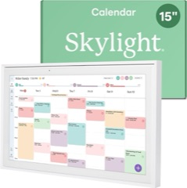
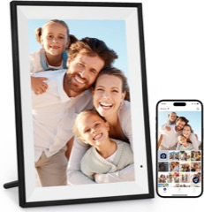
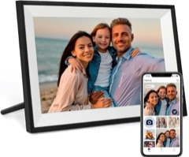
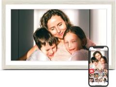

# Device index

Every frame documented in this repo. Each row is a record of the units its owners tested.
Frames sold under the same name can have different boards, so match the About screen, not the
brand: the same Amazon listing has shipped different boards. Links on amazon.com are affiliate
links. Rows marked "no write-up yet" are confirmed working but not documented here; notes are
welcome. Missing yours? See the README's
[contributing section](../README.md#check-for-updates-and-send-back-what-you-find).

| Device&nbsp;&nbsp;&nbsp;&nbsp;&nbsp;&nbsp;&nbsp;&nbsp;&nbsp;&nbsp;&nbsp;&nbsp;&nbsp;&nbsp;&nbsp;&nbsp;&nbsp;&nbsp;&nbsp;&nbsp;&nbsp;&nbsp;&nbsp;&nbsp;&nbsp;&nbsp;&nbsp;&nbsp;&nbsp;&nbsp; | SoC, Android | ADB out of the box | Root | Start with | Where owners bought it |
| --- | --- | --- | --- | --- | --- |
|  Skylight Calendar 15" (150-CAL, USB name `rockchip D156`) | Rockchip RK3566, Android 12 | Varies by firmware. `user` build (`skylightOS-D156-user-…`): no, hidden 5-tap manufacturer menu. Firmware `D156.V0.10` (`userdebug`): yes, USB, no prompt (key check appears to be off; one unit); needs a micro-USB data cable | `user` build: boot ramdisk `/force_debuggable`, then `adb root`. `D156.V0.10`: built-in `su 0` | [next-session.md](next-session.md); firmware `D156.V0.10`: [skylight-d156.md](skylight-d156.md) | [Amazon](https://www.amazon.com/dp/B0C9V811L6?tag=webo080-20) (`D156.V0.10` listing not recorded) |
|  BIUFRAME 10.1" (Synergy 10X1), the frame in the video | Rockchip RK3126, Android 6.0.1 | Yes, USB, accept the prompt | Shipped SuperSU `su` | [biuframe-setup-guide.md](biuframe-setup-guide.md) | [Amazon](https://amzn.to/4zneGNM), the listing from the video. It now often ships the PF1007L (#27) |
| YIAISIGN 10.1" (`10X1`, firmware `dpf01m1a_user_YJ`) | Rockchip RK3126, Android 6.0.1. Same model name and vendor app as the BIUFRAME, but a different build and partition layout | Yes, USB, accept the prompt | Shipped SuperSU `su` | [yiaisign-10x1.md](yiaisign-10x1.md). `biuframe-setup.sh check` fails; run its steps one at a time | Not recorded |
| ARZOPA frame (firmware `dpf01m1a_user_JVSHI`, USB `2207:0012`) | Rockchip RK3126, Android 6.0.1. Same build as the YIAISIGN `10X1`, different partition layout; AIC8800 Wi-Fi | Arzopa Settings → About, tap Software version 5×, ADB toggle, code `arzopazxcv` | Shipped SuperSU `su` | [arzopa-frame.md](arzopa-frame.md). `biuframe-setup.sh check` fails; run its steps one at a time | Not recorded |
| Tibuta 10.1" (`TID10`, Frameo, firmware `TID10_Tibuta_Frameo1.29`) | Rockchip RK3126, Android 6.0.1. Same build and partition layout as the YIAISIGN `10X1`; stock WebView 107 | Frameo Settings → ADB access, USB. Needs a **USB-A to USB-C** data cable; USB-C to USB-C does not enumerate | Shipped SuperSU `su` | [tibuta-tid10.md](tibuta-tid10.md). YIAISIGN route without the WebView step | Not recorded |
|  PF1007L / AiMOR (sold as BIUFRAME and others) | Allwinner A33, Android 6.0.1 | Varies by firmware | Boot patch, or root ADB once `adbd` runs | [pf1007l-start-here.md](pf1007l-start-here.md) | Reported from [Humblestead, US](https://amzn.to/4zneGNM) (#27), [Humblestead, Spain](https://www.amazon.es/dp/B0GGB7LWX8) (#18) and [Anna Bella, Canada](https://www.amazon.ca/dp/B0H4W1YPHH) (#28) |
| PF1006 (AiMOR 6.0.26, firmware `YHK.F-null-A33-1001-D1024-PF1006-46-DL-OS-AM.0.20240910`), **no USB port**, DC jack + full-size SD slot. Other PF1006 builds differ: check the firmware string | Allwinner A33 (`sun8i`, model `AEEZO`), Android 6.0.1, same eMMC layout as the PF1007L | No. TCP 5555 refused; 8086 open (AiMOR). The test-app ADB switch is USB-only, so no use here | Root ADB over Wi-Fi via [T3c](pf1007l-start-here.md#t3c-temporary-adb-through-the-aimor-connection) (router DNS record for `imsconnect.efercro.com`), made persistent with `persist.adb.tcp.port=5555`; no flash write | [pf1006-20240910-wifi-only.md](pf1006-20240910-wifi-only.md) (#159) | Same firmware reported from [Humblestead B0BJDR9G3X](https://www.amazon.com/dp/B0BJDR9G3X) (#142); this unit's listing not recorded |
| PF1006 V43, board `ZM789_MB_V4.3`, firmware `20240423` | Allwinner A33, Android 6.0.1 | No; stock USB mass storage only | Root USB ADB after a verified boot-ramdisk patch | [PF1006 V43 unit report](pf1006-v43-report.md) | Not recorded |
| Joyhong JT101F-I02 (Frameo) | Allwinner A33, Android 6.0.1 | **Yes, root over Wi-Fi, no key check** | Root ADB | [joyhong-jt101f-i02.md](joyhong-jt101f-i02.md) | Not recorded |
| Joyhong JT101F-C01 (Frameo) | Allwinner A33, Android 6.0.1. Identical build fingerprint to JT101F-I02, but a different boot-partition hash | **Yes, root over Wi-Fi, no key check** | Root ADB | [joyhong-jt101f-c01.md](joyhong-jt101f-c01.md) | Not recorded |
| Pastigio / SOMY ZC002 10.1" (Frameo, build `ZC002_20260313`) | Allwinner A33, Android 6.0.1 | USB stays `unauthorized`; no authorization dialog | Shipped `su` (`su 0 <cmd>`) after adding a host key to userdata (SOMY report); historical boot patch tested on Pastigio | [Pastigio report and read-only SPL](pastigio-zc002.md), [SOMY report in #73](https://github.com/wesbos/photo-frame-dashboard/pull/73). Route U backup verified on SOMY; Route U worked on a [second Pastigio unit](pastigio-zc002.md#second-pastigio-unit) at 4-bit 26 MHz | [Pastigio Amazon B0D41ZMYB2](https://www.amazon.com/dp/B0D41ZMYB2); SOMY listing not recorded |
| Rovesky 10.1" (Uhale 5.1.1), **has an internal battery** | Allwinner A33 `astar_d7`, Android 6.0.1 | **Yes, USB, no prompt (no SystemUI). `adbd` also listens on 5555; key check untested** | Shipped SuperSU-style `su` (not setuid), no prompt | [uhale-a33-astar-d7.md](uhale-a33-astar-d7.md) | [Amazon US](https://www.amazon.com/dp/B0G3N3BNJW) |
| QOCEN J1008 10.1" (Frameo, firmware `A103T-V1.0-frameo26-250723`) | Allwinner A33 `astar_d7`, Android 6.0.1 | Frameo Settings → About → ADB access, USB. Needs a USB-A to USB-C data cable; USB-C to USB-C does not enumerate. `adbd` also listens on 5555; key check untested | Shipped `su`, no prompt | [qocen-j1008.md](qocen-j1008.md) | Not recorded |
|  Dragon Touch Modern10 Charm (VPhoto) | Allwinner A33 (inferred; same `astar_ococci` platform as the Joyhong), Android 6.0.1 | Yes, root over Wi-Fi | Root ADB | [dragontouch-modern10-charm.md](dragontouch-modern10-charm.md) | [Amazon US](https://www.amazon.com/dp/B0D8J5PNFH?tag=webo080-20) (same model name; the tested unit came from [Amazon UK](https://www.amazon.co.uk/dp/B0DXV3HGH7)) |
|  Pastigio FRAME156 15.6" (Frameo) | Rockchip RK3326, Android 8.1. Frameo About may say `DPF Frame 156` | Frameo Settings → Beta → ADB Access | Shipped `su`. WebView 138 replaced the vendor 106 in `/system` on firmware `v2026051219` | [pastigio-frame156.md](pastigio-frame156.md) | [Amazon](https://www.amazon.com/dp/B0CQN2PKQR?tag=webo080-20) (sold as FRAME156; not confirmed as the tested listing) |
| Dragon Touch Classic10 Charm (Frameo). **Not** the Modern10 Charm (row above): different model, no VPhoto | Allwinner A33 `sun8i`/`astar_ococci`, Android 6.0.1, WebView 106 | **Yes, root over Wi-Fi :5555, no prompt** (`com.android.systemui` disabled out of the box, no key check observed); USB-A host port did not enumerate | ADB shell already `uid=0` with full capabilities; `/sbin/busybox` present; `/system/xbin/su` untested | [dragontouch-classic10-charm.md](dragontouch-classic10-charm.md) | [Amazon US, ASIN B0GTLPX5LC](https://a.co/d/0elUZPxy) |
| Dragon Touch Classic10 (`Classic10_A33M187_20250910-1617_V09`, stock app `com.waophoto.smartframe`; distinct from Classic10 Charm/Frameo) | Allwinner A33-family (inferred), Android 6.0.1 | USB ADB verified; factory state and authorization prompt not recorded | Root shell over USB | [dragontouch-classic10.md](dragontouch-classic10.md). Stock WebView 44 upgraded to 106; Home HQ verified | Not recorded |
|  Pastigio FRAME156 15.6" (Frameo) | Rockchip RK3326, Android 8.1 | Frameo Settings → Beta → ADB Access | Shipped `su` | [pastigio-frame156.md](pastigio-frame156.md) | [Amazon](https://www.amazon.com/dp/B0CQN2PKQR?tag=webo080-20) (sold as FRAME156; not confirmed as the tested listing) |
| Pastigio FRAME157 15-inch (Frameo) | Rockchip RK3326, Android 8.1 | No. Frameo ADB Access gives `unauthorized` with no prompt; host key written to userdata `adb_keys` from Loader after a verified backup | Shipped `su` | [pastigio-frame157.md](pastigio-frame157.md) | Not recorded |
| Rollei Smart Frame WiFi 107 10.1" (`SmartFrameWiFi107`, Frameo) | Rockchip RK3126, Android 6.0.1 | **Yes, USB, no prompt; key check appears to be skipped** (one computer tested; needs a USB-A to USB-C cable) | Shipped `su` | [rollei-smartframe-107.md](rollei-smartframe-107.md) | [Verkkokauppa.com, Finland](https://www.verkkokauppa.com/fi/product/1019555/Rollei-Smart-Frame-WiFi-107-digitaalinen-valokuvakehys-musta) |
| Skyrhyme 168 10.1" (Frameo, model `K1003BTCX`, build `user.zhihec.20231205`) | Rockchip RK3126, Android 6.0.1, 1 GB RAM, WebView 44 | Frameo ADB access toggle; turns on USB **and** network ADB (port 5555), micro-USB | Shipped `su`, no prompt | [skyrhyme-168.md](skyrhyme-168.md). Rollei 107 layout, Denver WebView step; its `daemonsu` service remounts `/system` every 5 s | [eBay](https://www.ebay.com/itm/920018877467) |
| Denver PFF-1015 10.1" (Frameo, firmware `F608D_V10_ZhiHeXing-PFF-1015-V1.0.1202302221059`), **512 MB RAM** | Rockchip RK3126, Android 6.0.1, low-RAM build (`ro.config.low_ram=true`) | Frameo Settings → Beta program → ADB access, USB. Authorized with no prompt and no `adb_keys`; key check appears to be skipped (one computer tested) | Shipped SuperSU `su`, no prompt | [denver-pff-1015.md](denver-pff-1015.md). Its low-RAM mode kills any app you leave unless it is whitelisted in `/system/etc/lowmem_package_filter.xml` | Not recorded |
| Denver PFF-711 7" (Frameo, build `rockchip/esp8089/esp8089:6.0.1/MXC89K/user.bnd_shh.20180321.205816`), **512 MB RAM** | Rockchip RK3126, Android 6.0.1, low-RAM build, NAND | No. Frameo Settings → About → Beta program starts `adbd`, but it stays `unauthorized` with no prompt (SystemUI disabled). Loader via the **Upgrade** button on the board, then the host key added as `/adb_keys` to the `KRNL` boot ramdisk | Shipped SuperSU `su`, once the host key is in | [denver-pff-711.md](denver-pff-711.md). `boot` is a `KRNL` image: [`krnl-add-adb-key.py`](../scripts/krnl-add-adb-key.py). Low-RAM mode kills a kiosk you leave, as on the PFF-1015 | Not recorded |
| Denver PFF-1024BMK2 10.1" (Frameo, firmware `F606C_ZhiHeXing_Frameo_1004-V1.0.1202405271346`), **512 MB RAM** | Rockchip RK3126, Android 6.0.1. Same vendor and partition layout as the PFF-1015, but no low-RAM mode | Frameo Settings → Beta program → ADB access, USB. Authorized with no prompt and no `adb_keys`; key check appears to be skipped (one computer tested) | Shipped SuperSU `su`, no prompt | [denver-pff-1024bmk2.md](denver-pff-1024bmk2.md). PFF-1015 route without the low-RAM whitelist or CA roots | Not recorded |
| AVYONA AVN-DPF1009 10.1" (Frameo, firmware `F601_ZhiHeXing_1009-V1.0.1202510091510`, model `Frame`) | Rockchip RK3126, Android 6.0.1, 1 GB, not low-RAM. Same ZhiHeXing layout as the Denver, WebView 107 | Frameo Settings → ADB access, USB; needs a **USB-A to USB-C** data cable. No prompt can appear (SystemUI disabled) | Shipped SuperSU `su` (`su 0 <cmd>`), no prompt | [avn-dpf1009.md](avn-dpf1009.md) | Not recorded |
| Veidoo Frame 10.1" (F10, firmware `F606C_WeiDu_Frameo-V1.0.1202603071359`) | Rockchip RK3126, Android 6.0.1 | Frameo Settings → About → Beta Program → ADB Access, USB. `adbd` also listens on 5555; key check untested | Shipped SuperSU `su`, no prompt | [veidoo-f10.md](veidoo-f10.md) | Not recorded |
| VESWWE DP100 10.1" (Frameo), `ro.product.model` `DP100`. Same About screen as the next row: check the model | Rockchip RK3326 (S101 board), Android 8.1, NAND | Frameo beta menu, USB | Shipped `su` and `adb root` | [veswwe-10.1.md](veswwe-10.1.md) | Not recorded |
| VESWWE DP100 10.1" (Frameo), `ro.product.model` `DP101`, build `DP101_Frameo_V02_26061607` | `ceres` platform (SoC not confirmed), Android 10, WebView 113 | Frameo Settings → About → Beta Program → ADB access, USB | Not needed; not tested | [veswwe-dp101.md](veswwe-dp101.md) | [Amazon.ca](https://www.amazon.ca/dp/B0H2FC19YB); [Amazon.nl](https://www.amazon.nl/dp/B0H6NQVZGW) (second unit, same build) |
| Frameo "Digital Photo Frame 102k" (KJM). Same name as an Allwinner A33 unit (next row): check the fingerprint | Rockchip RK3326 (S101 board), Android 11 Go, NAND | Frameo Settings → About → Beta Program → ADB Access. USB needs a USB-A to USB-C cable | None: `su` fails with `setgid failed` | [frameo-rk3326-s101.md](frameo-rk3326-s101.md) | Not recorded |
| Frameo 10.1" "102K" (ALONG, firmware `102K-MS33-HK9365-frameo_V1.29.13_NOPMU_20260113`). Same `Digital Photo Frame` model and `102K` name as the KJM unit (previous row): check the fingerprint | Allwinner A33 `astar_xr819`, Android 6.0.1, WebView 106 | **Yes, USB, no prompt (SystemUI disabled) and no key on file; the key check appears to be off** (two units, one computer each; USB-A to USB-C cable through a hub on the first). No network ADB listener | Shipped setuid `su` (`su 0 <cmd>`), no prompt; keeps only `CAP_SETUID`/`CAP_SETGID` | [frameo-102k-a33.md](frameo-102k-a33.md). A second unit [sold as 112K](frameo-102k-a33.md#second-unit-sold-as-112k) reports the same `102K` product and firmware and has the same boot image; smaller eMMC. Tested from Windows 11 | [Amazon.ca B088NHSVJN](https://www.amazon.ca/dp/B088NHSVJN) (first unit; 112K listing not recorded) |
| Frameo 10.1" "102K" (ALONG, firmware `102K-MS33-HK9365-frameo_V1.29.13_NOPMU_20260113`). Same `Digital Photo Frame` model and `102K` name as the KJM unit (previous row): check the fingerprint | Allwinner A33 `astar_xr819`, Android 6.0.1, WebView 106 | **Yes, USB, no prompt (SystemUI disabled) and no key on file; the key check appears to be off** (one computer tested; USB-A to USB-C cable through a hub). No network ADB listener | Shipped setuid `su` (`su 0 <cmd>`), no prompt; keeps only `CAP_SETUID`/`CAP_SETGID` | [frameo-102k-a33.md](frameo-102k-a33.md). Also sold as **"112K"** (box and About screen), with the same firmware and boot image; with internet blocked, [set a local NTP server](frameo-102k-a33.md#no-internet-android-6-can-hang-waiting-for-ntp) | [Amazon.ca B088NHSVJN](https://www.amazon.ca/dp/B088NHSVJN); "112K" from Amazon Australia (listing not recorded) |
| Frameo "Digital Photo Frame 102k" (KJM). Same name as an Allwinner A33 unit (next row): check the fingerprint | Rockchip RK3326 (S101 board), Android 11 Go, NAND | Frameo Settings → About → Beta Program → ADB Access. USB needs a USB-A to USB-C cable (works from a Mac's USB-A port) | None: `su` fails with `setgid failed` | [frameo-rk3326-s101.md](frameo-rk3326-s101.md) | Second unit: [Amazon México B088NHSVJN](https://www.amazon.com.mx/dp/B088NHSVJN), the same ASIN as the A33 unit (next row) |
| Frameo 10.1" "102K" (ALONG, firmware `102K-MS33-HK9365-frameo_V1.29.13_NOPMU_20260113`). Same `Digital Photo Frame` model and `102K` name as the KJM unit (previous row): check the fingerprint | Allwinner A33 `astar_xr819`, Android 6.0.1, WebView 106 | **Yes, USB, no prompt (SystemUI disabled) and no key on file; the key check appears to be off** (one computer tested; USB-A to USB-C cable through a hub). No network ADB listener | Shipped setuid `su` (`su 0 <cmd>`), no prompt; keeps only `CAP_SETUID`/`CAP_SETGID` | [frameo-102k-a33.md](frameo-102k-a33.md) | [Amazon.ca B088NHSVJN](https://www.amazon.ca/dp/B088NHSVJN). The same ASIN from Amazon México shipped the KJM RK3326 board (previous row) |
| Frameo 10.1" "102K" (ALONG, firmware `102K-MS33-HK9365-frameo_V1.29.13_NOPMU_20260113`). Same `Digital Photo Frame` model and `102K` name as the KJM unit (previous row): check the fingerprint | Allwinner A33 `astar_xr819`, Android 6.0.1, WebView 106 | **Yes, USB, no prompt (SystemUI disabled) and no key on file; the key check appears to be off** (one computer tested; USB-A to USB-C cable through a hub). No network ADB listener | Shipped setuid `su` (`su 0 <cmd>`), no prompt; keeps only `CAP_SETUID`/`CAP_SETGID` | [frameo-102k-a33.md](frameo-102k-a33.md) | [Amazon.ca B088NHSVJN](https://www.amazon.ca/dp/B088NHSVJN) |
| Frameo "Digital Photo Frame 114K" (Kejinming on the box; ALONG in the build, firmware `114119_HK9365_SWM0810_frameo_v1.29.13_20260114`). Same fingerprint as the Uhale 114KZ: check the firmware string | Allwinner A33 `astar_xr819`, Android 6.0.1, WebView 106, no battery | Frameo Settings → About → Beta Program → ADB Access, no prompt. USB only through a powered hub (USB-A to USB-C cable, hub with a charger on PD-IN); the Mac alone can't power it. No network listener; `setprop persist.adb.tcp.port 5555` makes Wi-Fi ADB persistent. **Key check enforced** over Wi-Fi | Shipped setuid `su` (`su 0 <cmd>`); keeps only `CAP_SETUID`/`CAP_SETGID` | [frameo-114k-a33.md](frameo-114k-a33.md) | Not recorded |
| Frameo 10.1" "101K" (ALONG, Frameo About shows hardware `101k`, firmware `114119_HK9365_SWM0810_frameo_v1.29.13_20260114`). Same firmware string and fingerprint as the Frameo 114K in open PR #122; same family as the Uhale 114KZ | Allwinner A33 `astar_xr819`, Android 6.0.1, WebView 106 | Frameo Settings → About → Beta Program → ADB Access, USB, accept the prompt. Restarted in a loop on Mac USB power until a better cable was used. **Network ADB across reboots after `su 0 setprop persist.adb.tcp.port 5555`** | Shipped setuid `su` (`su 0 <cmd>`), no prompt | [frameo-101k-a33.md](frameo-101k-a33.md) | Not recorded |
| Frameo 10.1" `BGS-102K-T` (ALONG, firmware `BGS-102K-T-M33-6.0-20240110`, Frameo v1.18.7). Same brand, platform and partition starts as the 102K (previous row), older firmware: check the fingerprint | Allwinner A33 `astar_xr819`, Android 6.0.1, **WebView 44**, `ro.config.low_ram=true` | USB on from `build.prop`, but `unauthorized` until Frameo → About → Beta program → ADB access was toggled with the cable in; then the prompt appeared (key check on). USB-A to USB-C cable through an adapter. No network ADB | Shipped setuid `su` (`su 0 <cmd>`), only `CAP_SETUID`/`CAP_SETGID`: `/system` remount refused, so no WebView swap | [frameo-bgs-102k-t.md](frameo-bgs-102k-t.md). Firefox installed web app + a Home app; Frameo resets Home and the time zone at boot until disabled | Amazon; listing not recorded |
| Uhale 102KZ 10.1" | Rockchip RK3126, Android 6.0.1 | On, but stays `unauthorized`: the prompt is hidden behind the Uhale kiosk | Shipped SuperSU `su`, once the host's ADB key is added to the boot ramdisk from loader mode | [uhale-102kz.md](uhale-102kz.md) | Amazon Japan; listing not recorded |
| Uhale 114KZ (firmware `114119_HK9365_uhale_SWM0810_uhale_photo_V5.1.1_20260114`), no battery | Allwinner A33, Android 6.0.1 | No usable USB ADB: the frame was unstable at startup with a USB data connection (suspected power limit). **ADB over Wi-Fi (5555) after a boot ramdisk patch with a host key; rejection of other keys untested** | Shipped `su 0` gives UID 0 but lacks `CAP_SYS_ADMIN`; ordinary system remount fails | [uhale-114kz.md](uhale-114kz.md) | Not recorded |
| Akimart ZN-DP1002 10.1" (Frameo), SSA RK3326 board; also sold as Dxmart ZN-DP1002. Same name as an RK3126 unit (next row): check the fingerprint | Rockchip RK3326, Android 8.1, NAND | Frameo ADB Access, USB only. Needs a USB-A to USB-C data cable | Shipped `su` (`su 0 <cmd>`) and `adb root` | [akimart-zn-dp1002.md](akimart-zn-dp1002.md) | [Amazon Australia](https://www.amazon.com.au/dp/B0F61WL5GD) |
| Akimart ZN-DP1002 10.1" (Frameo), RK3126 board | Rockchip RK3126, Android 6.0.1 (fingerprint `rockchip/rk312x/rk312x:6.0.1/MXC89K/user.cdm.20240816.163346`) | Yes, USB, accept the prompt | Shipped `su` | [biuframe-setup-guide.md](biuframe-setup-guide.md) (Akimart profile; `check` selects it by exact fingerprint, [#77](https://github.com/wesbos/photo-frame-dashboard/pull/77)) | Not recorded |
| AMABOO GBZK-Y1000 10.1" (Frameo, firmware `RAM_S101_20251229`, `ro.product.model` `RAM`). Same RK3326 partition map as the SSA RK3326 Akimart unit, different firmware and boot image | Rockchip RK3326, Android 8.1, NAND, WebView 106 | Frameo Settings → About → Beta Program → ADB access, USB, accept the prompt. Needs a USB-A to USB-C data cable | Shipped `su` and `adb root` | [amaboo-gbzk-y1000.md](amaboo-gbzk-y1000.md) | [Amazon.nl B0DYCSKZC3](https://www.amazon.nl/dp/B0DYCSKZC3) |
| LOOFII C-3 21.5" digital calendar | Allwinner A133 (`sun50iw10p1`), Android 10; now phh AOSP 12.1 GSI | Yes, USB, root `adbd` | Stock build is root; GSI is userdebug (`adb root`) | [allwinner-a133-loofii-c3.md](allwinner-a133-loofii-c3.md) | Amazon US: [LOOFII 21.5" Smart Digital Calendar](https://www.amazon.com/dp/B0FBVRT8C3?tag=webo080-20), the tested listing |
| C-2 10.1" digital calendar (box: Shenzhen Zhixingsheng Electronics Co; props: joyhong, firmware `C-2_A1339365080625_V05`, USB name `C-2`) | Allwinner A133 (`sun50iw10p1`, `ceres`), Android 10, WebView 74 | **Yes, root over USB, no prompt; also root on Wi-Fi port 5555 with no key check** | Stock root ADB; setuid `su` runnable by any app | [joyhong-c2-a133.md](joyhong-c2-a133.md). **Never disable the whole `com.waophoto.fota` package:** a framework boot hook launches it, and every app then crashes at boot. Disable only its `MessageService` | Amazon UK; listing not recorded |
| PF1506 (AiMOR 6.0.70, firmware `YHK.F-null-A133-1506-D2048-PF1506-V45-OS-KXW.0.20250813`) | Allwinner A133 (`ceres`), Android 10, WebView 74 | Varies: stock USB ADB on one unit (#104; how it was enabled is still being confirmed); MTP only (`1f3a:1006`) on another; never enumerated on a third (#118) | Shipped `su 0`, no prompt; `ro.adb.secure=0`, SELinux permissive | No write-up yet. Don't run the A33 PF1007L routes on it; the AiMOR DNS route (T3c-style) worked on one unit before its lockout (#118) | Not recorded |
| YunQiDeer YQ156001 15.6" (Frameo, firmware `ceres_mcx_V01_24071114`, USB `ceres-mcx`) | Allwinner A133 (`sun50iw10p1`, `ceres`), Android 10, WebView 74, 1 GB low-RAM build | Frameo Settings → About → Beta Program → ADB access, USB. Showed `unauthorized` until ADB access was toggled off and on with the cable in. Needs a **USB-A to USB-C** data cable (through a hub on a Mac); USB-C to USB-C does not enumerate. The USB-A port on the frame is host only | `adb shell` is root (`ro.secure=0`); shipped setuid `su`; SELinux permissive | [yunqideer-yq156001.md](yunqideer-yq156001.md) | [eBay 800520985117](https://www.ebay.com/itm/800520985117) |
| XORO CPF 10PF 10.1" (Uhale, build `eng.ctk.20260130.093021`), 1 GB RAM | Allwinner A133 (`sun50iw10p1`), Android 10 `eng`, 32-bit userspace, WebView 74 | **Yes, USB-C, root `adbd`, no prompt** although `ro.adb.secure=1` (one computer tested) | Root `adbd`. Also a shipped setuid `/system/xbin/su` that **any app** can run | [xoro-cpf10pf.md](xoro-cpf10pf.md). Same eMMC layout as the LOOFII C-3. Wi-Fi is 2.4 GHz without WPA3, and kernel suspend breaks touch | [Amazon Spain B0G2MJBR3M](https://www.amazon.es/dp/B0G2MJBR3M) |
|  PF1508 / AiMOR 6.0.100 (Anna Bella 15.6", firmware `YHK.F-null-A333-1506-D2048-C2-V10-PF1508-OS.0.20260725`) | Allwinner A333 (`sun65iw1p1`), Android 15, WebView 124 | No: MTP only (`1f3a:4ee1`). About → tap Model → test-app password (#135) → tick **adb调试**: persistent USB ADB, with the usual RSA prompt | None found (`user`/`release-keys`, verified boot `green`); not needed for the kiosk | [allwinner-a333-pf1508.md](allwinner-a333-pf1508.md) | [Anna Bella, Amazon US](https://www.amazon.com/dp/B0H4VVFPG6?tag=webo080-20) |
| Uhale SI006 | Spreadtrum `sp7731g_1h10`, Android 6.0 | No. Hidden Settings, then `unauthorized` | Terminal app `su`, then host key added to `adb_keys` | [si006-uhale.md](si006-uhale.md) | Not recorded |
| Uhale HSB / F10 (`F10_V1.01_20260826_195506`) | Spreadtrum `sc8830` platform / `sp7731gea` board, Android 6.0; existing WebView 107 | No. PTP only; AOA USB keyboard opened the browser, downloaded terminal enabled ADB, RSA prompt accepted | Shipped `su`; root USB ADB after enabling debugging | [uhale-hsb-f10.md](uhale-hsb-f10.md). Hidden tap menus did not work; local Home HQ build boots without a USB cable | Not recorded |
| VTimes VT01001 10.1" digital calendar (listing model `SMXK-003`, firmware `VTimes_VT01001_V01_202511101224`), same `si006asb` product as the SI006 | Spreadtrum `sp7731g_1h10`, Android 6.0, 2 GiB RAM; WebView 80 | On over USB from the box, but `unauthorized` with no prompt. No working hidden menu; AOA USB keyboard (Meta+B) opened the browser, APK copied over MTP. **`adbd` also listens on 5555** | Terminal app `su`, then host key added to `adb_keys`; `adb shell` is root (`ro.secure=0`) | [vtimes-vt01001.md](vtimes-vt01001.md). SI006 WebView overlay and CA roots worked unchanged | [Amazon US B0FLJTNRPH](https://www.amazon.com/dp/B0FLJTNRPH), the tested listing |
|  Runxion 10.1" (Frameo) | Rockchip RK3326, Android 8.1 | Frameo ADB Access toggle, USB. Showed `unauthorized` at first; toggling ADB Access off and on with USB plugged in brought up the authorize prompt | Shipped `su` (`su 0 <cmd>`) and `adb root` | No write-up yet | [Runxion 10.1" Frameo, 32 GB](https://amzn.to/4B38DQ0) |
|  Runxion 10.1" (Frameo) | Rockchip RK3326, Android 8.1 | Frameo ADB Access toggle, USB. Showed `unauthorized` at first; toggling ADB Access off and on with USB plugged in brought up the authorize prompt | Shipped `su` (`su 0 <cmd>`) and `adb root` | No write-up yet | [Runxion 10.1" Frameo, 32 GB](https://amzn.to/4B38DQ0). One unit arrived as an SSA ZN-DP1002 with an RK3126, Android 6.0.1 and eMMC, not this board: [runxion-zn-dp1002-rk3126.md](runxion-zn-dp1002-rk3126.md) |
|  15.6" Frameo | Not documented yet | Not documented yet | Not documented yet | Confirmed working; no write-up yet | [15.6" Frameo, 1920x1080](https://amzn.to/4zwU6e0) |
| Whale Framely 15.6" (`RAM_S915`, build `RAM_S915_15.6_20260623`), board `BND-S915-C A1.0` | Rockchip RK3326-S, PMIC RK817-6, 1 GB DDR, Android version not confirmed | **No.** USB enumerates as MTP (`2207:0001`) or PTP (`2207:0002`) only, through a USB-A host adapter on the computer side. No ADB interface, no open network ports, no working gestures or WebADB | Not reached. Vendor app `com.zeasn.frame`, updater `com.adups.fota` | [whale-framely-ram-s915.md](whale-framely-ram-s915.md). The unit's storage is readable over MTP; UART pads are unprobed | Not recorded |

Additional PF1007L success report:
[May firmware, TF-card FEL to a standalone Home Assistant panel](pf1007l-tf-card-20260529-home-assistant-report.md).
This unit used the card to enter FEL, then Route U over USB; it did not boot a
replacement Android system from the card.

## Details: the first three frames

|                    | Skylight Calendar 15" (150-CAL)                                | BIUFRAME 10.1" picture frame (in the video)      | PF1007L 10.1" picture frame (BIUFRAME and others)                                   |
| ------------------ | -------------------------------------------------------------- | ------------------------------------------------ | ----------------------------------------------------------------------------------- |
| SoC / Android      | Rockchip RK3566, Android 12                                    | Rockchip RK3126, Android 6.0.1                   | Allwinner A33, Android 6.0.1, AiMOR home app                                         |
| USB name / IDs     | `rockchip D156`, `2207:0007` (MTP) → `2207:0006` (ADB)         | `Synergy 10X1`, `2207:0006` (ADB)                | `1f3a:1000` (mass storage only); `1f3a:1001` / `1002` with ADB, depending on unit and route |
| Cable              | Not recorded                                                   | USB-C. The first cable gave nothing, the second worked | USB-C-only units need a **USB-A to USB-C** cable. USB-C to USB-C gives no power or data. The cable in the box is likely power only. It does not carry data. Use another cable that already allows data transfer. |
| ADB out of the box | No                                                             | Yes, accept the prompt on screen                 | Varies: some units ship with root ADB on, even with the same firmware as units that don't |
| How we got ADB     | Hidden 5-tap manufacturer menu in the Skylight app             | Already on                                       | Stock on some units; temporary ADB through AiMOR; or a boot patch from U-Boot over USB (FEL) or the SD card |
| Backup             | Rockusb loader, with a patched RAM helper to read past 32 MiB  | `dd` over ADB as root                            | Read-only U-Boot `ums` disk, or U-Boot dump to the SD card                           |
| Root               | Added `/force_debuggable` to the boot ramdisk, then `adb root` | Ships with SuperSU `su`                          | Stock build is debuggable: ADB shell is root once `adbd` runs                        |
| End result         | Lawnchair launcher, USB Wi-Fi dongle (onboard radio is dead)   | Firefox, launcher, WebView 106, custom kiosk app | Launcher, WebView 106, kiosk app. Vendor app has a remote root shell: disable it     |

## Patterns so far

- **Frameo frames** often have an ADB toggle under Settings → About → Beta Program.
- **Try ADB over the network** (`adb connect <ip>:5555`) as well as USB. Several Allwinner frames
  ship with root ADB open on Wi-Fi with no key check. That is convenient, but anything on the same
  network gets root, so keep these frames on an isolated network.
- **No SystemUI** (no status or navigation bar) is common. Then an ADB `unauthorized` prompt has
  nowhere to appear. SystemUI may be present but deliberately disabled (`pm disable`), not absent
  from the firmware — check `/system/priv-app/SystemUI` and `package-restrictions.xml` before
  assuming it is missing.
- **When no popup can ever appear**, adding the host's public key straight into
  `/data/misc/adb/adb_keys` (matching the `adb_keys_file` ownership/mode/SELinux context already
  on the device) authorizes ADB without one, and without touching the boot image or any binary.
  Seen on the Uhale SI006 and the SOMY ZC002.
- **Low-RAM Rockchip builds** (`ro.config.low_ram=true`) can kill every app the moment you switch
  away from it, including the kiosk and its navigation buttons, unless the app is listed in
  `/system/etc/lowmem_package_filter.xml`. See [denver-pff-1015.md](denver-pff-1015.md#low-ram-mode-kills-every-app-you-leave).
  Check `ro.config.low_ram` first: the newer [PFF-1024BMK2](denver-pff-1024bmk2.md#no-low-ram-killing)
  from the same vendor does not set it.
- **Cables:** several USB-C frames need a USB-A to USB-C data cable. The cable in the box is often
  power only.
